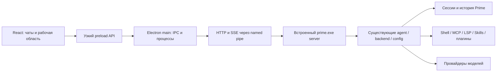

# Prime Desktop — проект приложения

Дата: 17 октября 2026. Статус: проектное предложение для реализации.

## 1. Результат

Самостоятельное Windows-приложение Prime Desktop с установщиком, графическим интерфейсом, встроенным Prime CLI и обновлением. Пользователь открывает приложение, выбирает папку проекта, подключает провайдера и работает в чатах. Консоль вручную запускать не требуется.

Рабочая логика остаётся в Prime: системные инструкции, контекст, модели, reasoning, агент, инструменты, сессии, очередь, разрешения, вопросы, MCP, LSP, Skills и плагины. Desktop отображает состояние и отправляет действия через API. Ответы провайдера не запрашиваются из React.

«Безэтапно» означает один согласованный объём законченного приложения и один набор условий приёмки. Технические задачи имеют зависимости, но не образуют урезанные пользовательские релизы с обещанием доделать основные функции потом.

Рабочее название: Prime Desktop, поскольку исходный проект в указанной папке называется Prime. Windows x64 — обязательная целевая платформа. Windows arm64 и Linux — структура и сборочные профили; считать их поддержанными только после отдельных сборок и проверки. macOS в этот объём не входит.

## 2. Проверенная исходная база

Исходники: `C:/Users/dwert/OneDrive/Documents/GitHub/CLI`, просмотренный HEAD `84fb9c2b`. На момент изучения `git status --short` пуст. Удалённая ветка не запрашивалась; перед реализацией требуется fetch и сравнение. Папка `CliDeckstop` на момент изучения пуста, Git-репозиторий не создан.

| Основа | Подтверждённые файлы | Значение для Desktop |
|---|---|---|
| Серверный режим | `internal/cmd/server.go` | Команда `prime server --host …` уже существует |
| Локальный транспорт | `internal/server/server.go`, `net_windows.go` | HTTP поверх Windows named pipe уже поддержан |
| API | `internal/server/endpoints.go`, `docs.go` | Маршруты и генерируемая OpenAPI-схема `/v1/docs/openapi.json` |
| Go-клиент | `internal/client/client.go`, `proto.go`, `config.go` | Образец семантики вызовов и обработки ошибок |
| Контракт интерфейса | `internal/workspace/workspace.go` | Перечень операций для матрицы функционального соответствия |
| Агент | `internal/backend/agent.go` | Асинхронное принятие запроса, очередь, отмена, shell, смена режима |
| События | `internal/server/events.go`, `proto.go`, `internal/pubsub/events.go` | SSE; message, session, file, run_complete, permissions, questions, MCP/LSP/Skills |
| Корреляция запуска | `internal/proto/proto.go` | `run_id` и завершающее `RunComplete` уже есть |
| Присутствие клиентов | `internal/backend/backend.go` | SSE удерживает workspace; есть create/detach grace и client retirement |
| Данные | `internal/proto/session.go`, `history.go`, `message.go` | История, стоимость, токены, todos, версии файлов, вложения |
| Настройки | `internal/server/config.go`, `internal/config` | Настройки сохраняет backend; `primerc` является исполняемой конфигурацией |
| Reasoning | `internal/cmd/model_reasoning.go` | Нельзя независимо изобретать соответствия уровней в Desktop |
| Плагины | `internal/plugins`, `internal/ui/dialog/commands.go` | Требуется отделить консольные элементы управления от сервисов |
| Обновления | `internal/cmd/update.go`, `.goreleaser.yml` | CLI имеет собственный канал релизов и `prime update` |

Это исследование исходников, а не подтверждение успешной сборки или запуска существующего CLI. Локальные `CLI.exe` и `dist` могут не соответствовать HEAD; использовать их в поставке без проверки версии нельзя.

## 3. Выбор архитектуры

| Вариант | Достоинства | Цена | Решение |
|---|---|---|---|
| Electron + React + существующий сервер Prime | Node HTTP поддерживает socketPath; готовая основа для IPC, окон, фонового процесса и rich UI | Более крупный дистрибутив и потребление памяти | Рекомендован |
| Tauri + React + сервер Prime | Более лёгкая оболочка | Дополнительный Rust-адаптер транспорта и supervision, больше разных технологий | Допустим при отдельном требовании к размеру |
| Терминал с Prime TUI внутри окна | Быстрый запуск | Сохраняет терминальный UX и мешает структурированному отображению | Не соответствует желаемому интерфейсу |

Рекомендуемый стек: Electron, React, TypeScript strict, Vite, CSS variables, Radix primitives, Lucide, Zustand для состояния окна, TanStack Query для снимков API, Zod для проверок границ, react-markdown с отключённым raw HTML, Monaco для просмотра кода и diff, Vitest, React Testing Library, Playwright Electron, electron-builder и electron-updater. Версии зафиксировать в lockfile при реализации после проверки официальной совместимости. Существующего frontend-стека в папке Desktop нет.



## 4. Процессы, транспорт, жизненный цикл

1. Electron получает single-instance lock. Второй запуск активирует уже открытое окно.
2. Main читает manifest встроенного CLI, проверяет checksum, выполняет handshake и проверяет capabilities.
3. По умолчанию запускается приватный bundled runtime через `spawn(binaryPath, args, { shell: false, windowsHide: true })`. Путь и аргументы передаются отдельно. Консольное окно не появляется, stdout/stderr читаются и ротируются.
4. Адрес вида `npipe:////./pipe/prime-desktop-<user>-<instance>` передаётся через `--host`. Main использует Node HTTP `socketPath`. Renderer не получает доступ к pipe или произвольному HTTP.
5. Pipe ограничивается текущим Windows-пользователем; требуется проверить текущие ACL и добавить явное ограничение на стороне Prime. Имя pipe само по себе не является авторизацией. Для Linux аналог — unix socket в каталоге пользователя с ограниченными правами.
6. Main ожидает health до 15 секунд с интервалом 200 мс; ошибка содержит причину и действие «Повторить». Сохраняет PID, версию и факт владения процессом.
7. Выбор проекта создаёт/присоединяет workspace с `client_id`. Сначала открывается SSE, затем загружаются снимки и инициализируется интерактивный агент. Без живого SSE отправка заблокирована.
8. Main удерживает SSE каждого открытого проекта даже при переключении чата. Обновление React не снимает эти соединения. Отдельное окно получает отдельный client ID; корреляция событий включает workspace и session.
9. Закрытие окна во время работы по умолчанию сворачивает приложение в tray, сохраняет процесс и соединения; уведомление объясняет это поведение. Пункт «Выйти» предлагает дождаться завершения либо остановить задачи и выйти. Idle-выход освобождает client claims и запрашивает `shutdown_if_idle` только у собственного сервера.
10. Переподключение: 250 мс, 500 мс, 1, 2, 5 секунд, далее 5 секунд с jitter. UI показывает «Восстанавливаем соединение». Не сообщает, что агент остановился, только из-за обрыва SSE.
11. При падении owned backend допускаются три попытки перезапуска за минуту; затем экран диагностики. Сохранённая история восстанавливается; незавершённый запуск отмечается прерванным. Команды с побочными эффектами автоматически повторно не выполняются.
12. Подключение к внешнему установленному Prime — расширенная настройка с проверкой capabilities. Такой процесс Desktop не завершает и не обновляет. Несовместимость объясняется до открытия рабочего чата.

Предотвратить гонки запуска двумя процессами, не освобождать чужие workspace и не завершать сервер из-за закрытия одного чата. Поведение сна/пробуждения Windows проверяется отдельно.

## 5. Контракт и пробелы API

База `/v1/workspaces/{id}`. Примеры существующих маршрутов:

| Функция | Существующая поверхность |
|---|---|
| Проекты | `/v1/workspaces`, `/v1/workspaces/{id}`, `current-session?client_id=…` |
| Чаты | `sessions`, `sessions/{sid}`, `sessions/{sid}/messages`, `sessions/{sid}/history` |
| Поток | `events?client_id=…` |
| Запуск | POST `agent`, POST `agent/init`, GET `agent` |
| Отмена | POST `agent/sessions/{sid}/cancel` |
| Очередь | GET `agent/sessions/{sid}/prompts/queued`, GET `…/list`, POST `…/clear` |
| Режим | POST `agent/main`, POST `agent/update` |
| Сжатие | POST `agent/sessions/{sid}/summarize` |
| Команда | POST `agent/sessions/{sid}/shell` |
| Разрешения | POST `permissions/grant`, GET/POST `permissions/skip` |
| Вопросы | POST `questions/answer`, POST `questions/cancel` |
| Настройки | POST `config/set`, `config/remove`, `config/model`, `config/provider-key`, `config/compact` |
| OAuth | `config/import-copilot`, `config/refresh-oauth`, `mcp/pending-auth`, `mcp/auth-url`, `mcp/auth` |
| Ресурсы | `skills`, `skills/read`, `lsps`, `lsps/{lsp}/diagnostics`, `mcp/states`, `mcp/prompts` |

SSE сейчас отправляет `data: <JSON>`, без sequence, replay и `Last-Event-ID`. Его envelope уже различает типы, а внутреннее событие содержит действие и payload. TypeScript-клиент должен воспроизводить реальный envelope, а не считать все сообщения текстовыми delta.

`run_id` сейчас коррелирует события; доказательства дедупликации повторных POST не обнаружено. Таймаут отправки не означает, что задача не принята.

Обязательные дополнения в CLI, с сохранением существующих маршрутов:

| Новая поверхность | Точный смысл |
|---|---|
| GET `/v1/capabilities` | `protocol_version`, feature flags и версия схемы; версия бинарника отдельно |
| GET `…/snapshot` | Атомарный снимок с `generation`, `cursor`, сессиями, текущими сообщениями, очередями, pending permissions/questions, ресурсами и состояниями запусков; выбираемая session через query |
| SSE `id`, `generation` и replay | Ограниченный журнал на workspace: 10 000 событий или 16 MiB; устаревший cursor требует snapshot; смена generation требует полного согласования |
| GET `…/runs/{run_id}` | `accepted`, `queued`, `running`, `completed`, `cancelled`, `failed`, `interrupted`; хранить запрос и терминальный статус с историей |
| POST `agent` с дедупликацией | Один `run_id` и тот же payload возвращают исходное принятие; другой payload с тем же ID — 409; зафиксировать принятие до исполнения |
| API плагинов | GET `…/plugins`, POST `…/plugins/{name}/enable`, `…/disable`, GET `…/plugins/tasks`; состояние установки и ошибки передаются событиями |
| Голос | POST `…/voice/transcribe` с аудио, типом и языком; возвращает текст, не отправляет его агенту |
| Возможности модели | GET `…/models/capabilities`; POST `…/config/reasoning` использует те же Go-функции нормализации, что CLI |
| Каталог команд | GET `…/commands`: пользовательские команды и поддерживаемые встроенные действия; MCP prompts остаются в существующем API |
| Background jobs | GET `…/sessions/{sid}/jobs`, события их состояния; stop с той же семантикой дочерних работ, что у CLI |

Время хранения записей запусков — срок хранения сессии; replay хранится в памяти и обнуляется с generation. Снимок не передаёт ключи провайдеров в React. Дополнить OpenAPI из `endpoints.go`, Go-клиент и тесты; генерация типов не должна требовать раскрытия приватных Go-пакетов.

Восстановление: подписаться на поток, буферизовать события, получить snapshot, применить только события его generation с cursor больше snapshot cursor. Далее обновления по ID и revision. Если буфер переполнен — новый snapshot. Никакого двойного добавления сообщений или позднего события предыдущего проекта.

## 6. Матрица полного поведения

| Возможность Prime | Desktop-поведение | Проверка |
|---|---|---|
| Проект и инструкции | Выбор папки, recent projects, индикатор AGENTS/PRIME/ignore; использует backend discovery | Та же папка даёт тот же набор инструкций |
| История | Создание, продолжение, переименование, удаление с подтверждением, поиск и локальное закрепление | Перезапуск сохраняет IDs и сообщения |
| Ответы | Markdown, код, таблицы, вложения, видимые reasoning-блоки только если backend их отдаёт | Корректное обновление по message ID |
| Инструменты | Карточки с названием, параметрами, результатом, временем и ошибкой | Состояния pending/running/success/error/cancelled |
| Дочерние агенты и jobs | Иерархия работ и переход к дочерней истории | События не перемешиваются с родительскими |
| Очередь | Список ожидающих запросов, число, очистка всей очереди | Очередь backend — единственная истина |
| Отмена | Stop и двойной Esc останавливают текущую сессию и связанные работы | Другой чат продолжает работать |
| Coder / Plan | Переключатель у поля ввода; блокировка при busy согласно CLI | Backend отклоняет гонку смены режима |
| YOLO | Явное включение на уровне workspace, постоянный индикатор | Нет неявного auto-approve из Desktop |
| Разрешения | Один раз / на сессию / запретить, показ пути, команды или diff | Повторный ответ другого клиента безопасен |
| Вопросы | Single/multi select, свободный ответ, yes/no, заметки и отмена | Batch ID и tool call сохраняются |
| Модели | Провайдеры, свои endpoints, локальные модели, большая/малая модель | Сохранение через config scope backend |
| Reasoning | Только уровни и настройки, поддержанные выбранной моделью | Совпадает с CLI, включая off |
| Контекст | Токены, стоимость сессии, todos, compact/summarize и ход сжатия | Значения получены из backend |
| MCP | Конфигурация, статусы, tools, resources, prompts, refresh, OAuth, Docker toggle | Подключение и ошибка показаны честно |
| LSP | Диагностика, старт/остановка, restart systems | Счётчики соответствуют реальному состоянию |
| Skills | Каталог, источник, доступность, просмотр; отключённые видны | Обновление discovery приходит событием |
| Команды | Ctrl+P, slash commands, custom commands, MCP prompts | Аргументы и ошибки не теряются |
| Shell | Ввод прямой команды и сохранение результата в чате | Используется shell Prime и его cwd/env |
| Плагины | Каталог встроенных плагинов, install progress, toggle | Не создаётся альтернативная система плагинов |
| Voice | Alt+V, разрешение микрофона, запись, распознавание, редактируемый текст | Нет автоматической отправки; отказ не блокирует чат |
| Внешние каналы MCP | Опции workspace/channels и доставка поддержанных событий | Если TUI поддерживает, Desktop получает адаптер; unsupported событие не подменяется |
| Темы и язык | Русский по умолчанию, английский, dark/light/system | Формат дат/стоимости и язык сохраняются |
| Обновления | Desktop вместе с bundled CLI, внешняя установка отдельно | После обновления чаты и конфигурация сохранены |

Финальная сверка включает все команды из `internal/ui/dialog/commands.go`, методы `internal/workspace/workspace.go` и настройки из `schema.json`. TUI-специфичные рамки и ASCII-анимации получают графические эквиваленты. Для каждой позиции перед релизом фиксируется реализованный сценарий; неперенесённая рабочая функция блокирует заявление о полном соответствии.

## 7. Интерфейс

Ориентир — организация DeepSeek Harness: workspace, сессии, composer, сворачиваемые действия и просмотр результатов. Собственные ресурсы Prime и его режимы остаются доступными. Не включать отсутствующие в Prime расписания, магазин внешних плагинов или облачную синхронизацию только ради сходства.

```text
┌─ Prime Desktop ─────── Проект / Чат ──── Поиск ──── Состояние ────┐
│ + Новый чат      │                                  │ Файлы      │
│ Открыть проект   │  Сообщение пользователя           │ Изменения  │
│                 │                                  │ Ресурсы    │
│ Проект A        │  План · 2 из 4                    │            │
│   Чат 1         │  ▸ Прочитаны файлы                 │ main.go    │
│   Чат 2  ●      │  ▾ Изменён main.go                 │ +12 −4     │
│ Проект B        │    diff / результат               │            │
│                 │  Ответ с кодом                    │ MCP · 3    │
│                 │                                  │ LSP · 1    │
│ Плагины         │  ┌ Сообщение…  @ файлы  / команды┐ │ Skills · 8 │
│ Настройки       │  │ Plan/Coder · модель · reasoning│ │            │
│                 │  └ Вложения    права    Stop/Send┘ │            │
└─────────────────┴──────────────────────────────────┴────────────┘
```

Слева 240–300 px: проекты и чаты, поиск, статусы работы/ожидания/ошибки, pinned и recent. Центр занимает свободное место, текст ответа ограничен примерно 860 px. Справа 320–480 px, скрываемая панель с вкладками «Файлы», «Изменения», «Ресурсы», «Задачи». Разделители перетаскиваются, размеры сохраняются. При ширине менее 1100 px правая область открывается поверх, при менее 900 px сворачивается sidebar. Минимальное окно 800×600.

Composer всегда снизу. Enter отправляет, Shift+Enter переносит строку, Ctrl+P открывает палитру, Ctrl+N создаёт чат, Ctrl+L открывает модели, Alt+V управляет диктовкой. В IME-composition Enter не отправляет. Esc закрывает overlay; двойной Esc в рабочем чате останавливает задачу. При конфликте modal/recording имеет приоритет. Во время чтения старых сообщений авто-scroll не перетягивает вниз; появляется «Новые сообщения».

Первый запуск: выбор проекта → обнаруженные настройки → подключение/проверка провайдера, если нужен → готовый чат. API-ключ не требуется повторно при корректно обнаруженной существующей конфигурации. Экран пустого чата показывает путь проекта, выбранную модель и три коротких действия. Errors, loading и empty state существуют у каждого экрана.

Дизайн обновлён по просьбе пользователя на стиль SpherePrime (sphereprime.ru): тёмный фон `#101010`, панели `#191919`, основной текст `#F1EFE9`, оранжевый акцент `#FF6A35` и вторичный `#FF8C60`. Используется оригинальная геометрия знака SpherePrime из трёх наклонённых полос. Шрифт интерфейса Inter, код JetBrains Mono; файлы шрифтов поставляются локально с кириллицей. Светлая тема использует тёплые светлые поверхности и контрастный оранжевый. Тонкие границы, умеренные скругления и компактная рабочая компоновка. Сведения об источнике: `docs/brand.md`.

Keyboard navigation, заметный focus, screen-reader labels, контраст текста ≥4.5:1, все icon-only действия с tooltip и accessible name. Панели изменяются с клавиатуры. Длинная история виртуализируется; стриминг объединяется в обновления не чаще одного кадра. Проверить 1000+ сообщений, большие результаты инструментов, масштаб Windows 125/150/200%.

## 8. Файлы и изменения

Main имеет отдельный read-only сервис файлов: список внутри выбранного root, lazy tree, просмотр текста/изображений, запрет чтения через выходящий за root symlink без явного выбора пользователем. Файл до 2 MiB открывается текстом, больший — предупреждение и внешнее приложение. Бинарные файлы не декодируются как текст. `@`-поиск соблюдает ignore-политику; вложение явно выбранного исключённого файла показывает это пользователю.

Diff «изменения сессии» строится по истории Prime и текущему содержимому с указанием версии. Git diff — отдельное сравнение с HEAD/worktree через Git CLI аргументами без shell; не приписывать все пользовательские изменения агенту. Включить untracked, renamed и deleted, LF/CRLF, UTF-8, пробелы и кириллицу в путях. При отсутствии Git история Prime остаётся доступна. Изменения агента уже записаны на диск: кнопка «Применить» не изображает несуществующий pending patch. В этом объёме нет автоматического отката, stage, commit и push из UI. Открыть файл в редакторе и папку в Explorer можно.

## 9. Данные и границы доступа

История, очереди, настройки моделей, credentials и правила инструментов принадлежат backend Prime. Desktop не пишет напрямую в SQLite и не создаёт вторую БД чатов. UI-предпочтения, размеры окон, recent paths, pinned IDs и черновики — versioned local store в Electron userData; атомарная запись и миграция. Черновик хранится по canonical project path + session ID, а не только по временному workspace ID. Удаление приложения по умолчанию не удаляет пользовательские данные.

При первом обнаружении существующего хранилища проверить пути и совместимость схемы. Не открывать старую БД бинарником с неизвестной миграцией; создать резервную копию перед миграцией. Одновременный CLI и Desktop обязаны пройти тест совместного доступа к БД. Пока это не подтверждено, блокировать конфликтующий второй writer с понятной ошибкой; не создавать незаметно пустую копию истории.

Renderer: `nodeIntegration: false`, `contextIsolation: true`, `sandbox: true`; CSP для локальных assets, raw HTML в Markdown выключен. Узкий preload с методами предметной области, валидация IPC arguments и sender. Нельзя экспортировать произвольные `exec`, HTTP, filesystem или `ipcRenderer`. Ключи отправляются в backend через main, в renderer хранятся только на время формы и затем очищаются. Логи скрывают ключи, токены, env и чувствительные query. OAuth URL открывается только после проверки http/https; callback проверяет state. Не исполнять пользовательские настройки повторно ради previews: `primerc` уже является кодом и загружается backend.

## 10. Установка и обновления

Установщик Windows per-user без обязательных admin-прав; ярлыки, корректный uninstall, версия и иконка. В ресурсы включается проверенный Prime CLI, поэтому Go, Node и отдельная установка Prime пользователю не нужны. Git, LSP и внешние MCP runtime показываются как зависимости конкретных функций; не обещать, что bundled CLI включает их все.

Bundled manifest содержит Desktop version, CLI version, CLI commit, protocol version, platform/arch и SHA-256. CI собирает CLI из закреплённого SHA в проекте CLI, затем Desktop; не копирует случайный exe с машины разработчика. Матрица релизов проверяет handshake и минимальный end-to-end запуск до публикации.

Desktop обновляет оболочку и собственный CLI одним пакетом, после завершения задач и резервирования данных перед миграцией. `prime update` продолжает обслуживать внешнюю CLI-установку и не подменяет бинарник в resources Desktop. Обновление из tray не прерывает работу. Если update download/check не удался, текущая версия работает дальше. Downgrade runtime после миграции БД запрещён без совместимого backup. Подпись установщика и проверяемый update feed нужны для публичного релиза; отсутствие сертификата явно отражается в release status.

## 11. Критерии готовности

- Чистая Windows x64 машина запускает установленное приложение без Go/Node/Prime и без всплывающей консоли.
- Реальный тестовый provider или локальный API stub проходит полный цикл сессии, streaming, tool use, разрешения, вопроса и terminal RunComplete.
- Очередь, смена модели/reasoning, Plan/Coder, YOLO, attachments, MCP/LSP/Skills, плагины и voice имеют рабочие экраны и интеграцию.
- Stop завершает выбранную сессию и дочерние работы; параллельная другая сессия остаётся активной.
- Обрыв SSE, перезапуск renderer и повторное подключение не дублируют запуск, сообщения и разрешения. Падение backend честно показывает прерванный запуск.
- Переоткрытие проекта и приложения сохраняет историю, конфигурацию и черновики.
- Diff отличает историю сессии от Git diff. Пользовательские изменения не теряются.
- Tray, завершение, сон/пробуждение и обновление проверены при активной задаче.
- Установщик, uninstall, обновление с предыдущей тестовой версии и миграция проверены на VM.
- Все строки локализованы; keyboard-only сценарий и DPI-проверки проходят; проверен длинный чат.
- В финальной матрице команд CLI нет необъяснённых пропусков. Нет фиктивных кнопок, mock-only статусов и секретов в логах.

## 12. Источники проектных решений

- Локальные исходники Prime перечислены в разделе 2; локальное состояние зафиксировано отдельно от будущих изменений.
- DeepSeek Harness, официальный продуктовый ориентир: https://www.deepseek.com/en/harness/
- Electron isolation: https://www.electronjs.org/docs/latest/tutorial/context-isolation
- Electron security: https://www.electronjs.org/docs/latest/tutorial/security
- Node child process и `windowsHide`: https://nodejs.org/api/child_process.html
- Локальный ui-ux-pro-max: проверен результат Developer Tool / IDE; нерелевантный landing-page шаблон из общего поиска отклонён. Конкретная компоновка и токены выше — проектное решение для Prime Desktop.
